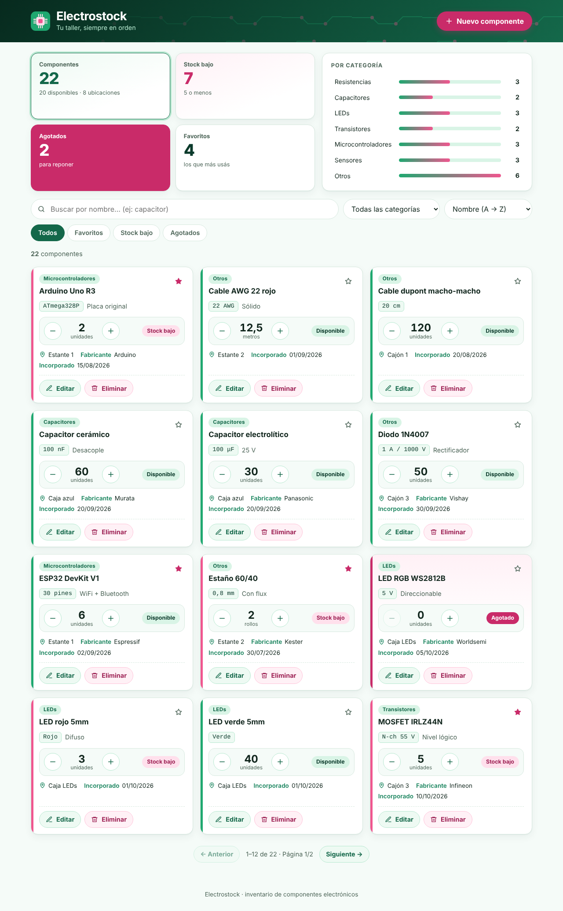
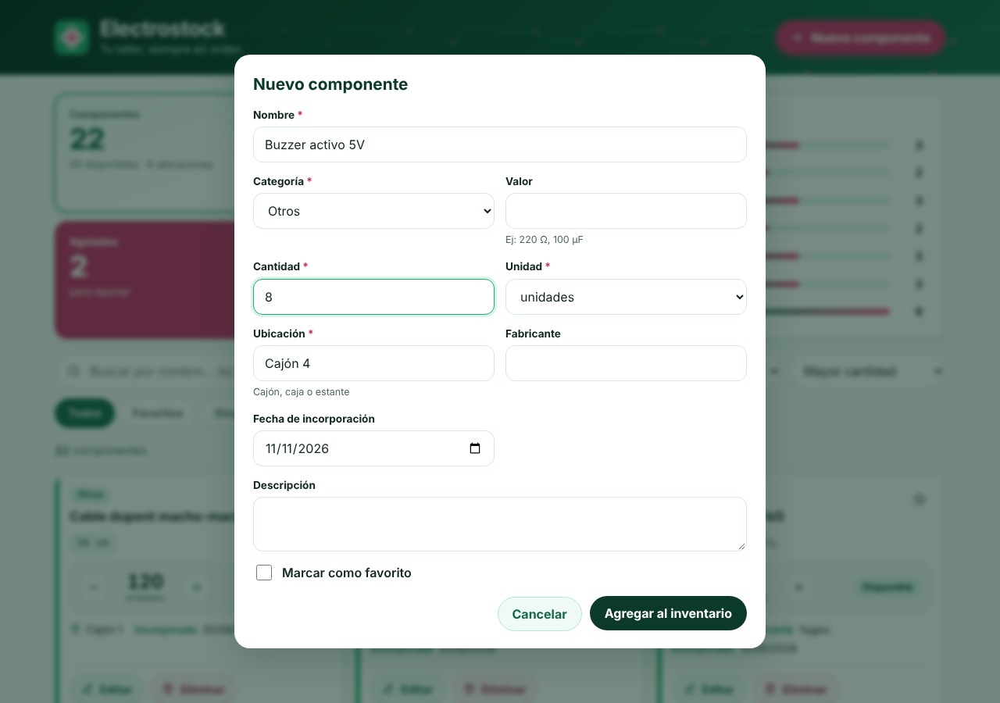
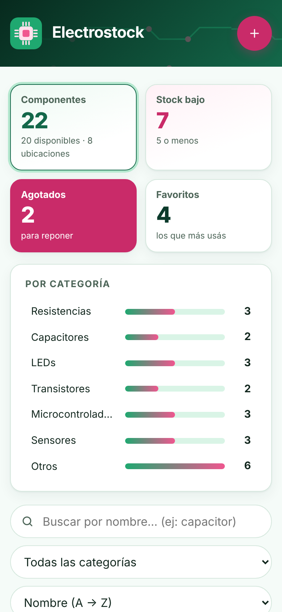

# ⚡ Electrostock

Aplicación web para organizar el inventario de componentes electrónicos de un taller o laboratorio: qué tenés, cuánto queda, dónde lo guardaste y qué hay que volver a comprar.

- **Frontend:** React + Vite + TypeScript + CSS (sin librerías de UI).
- **Backend:** Node.js + TypeScript, arquitectura **Controller → Service → Repository**, sin dependencias de runtime.
- **Persistencia:** archivo JSON con escritura atómica, detrás de una interfaz `Repository` (se puede cambiar por SQLite/PostgreSQL sin tocar las reglas de negocio).

Trabajo Práctico N.º 1 y Actividad de Backend — Zabala, Erika Morena.

## Capturas



| Formulario | Celular |
|---|---|
|  |  |

## Cómo ejecutarlo

Requiere **Node.js 22.18 o superior**.

```bash
npm run install:all     # instala backend y frontend
npm run seed            # (opcional) carga 22 componentes de ejemplo
npm run dev             # API en :3000 + interfaz en http://localhost:5173
```

Modo "producción" (un solo proceso que sirve API + interfaz):

```bash
npm run build
npm start               # http://localhost:3000
```

Otros comandos: `npm test` (tests del backend), `npm run typecheck`.

Variables de entorno del backend: `PORT` (3000), `DATA_FILE` (`backend/data/componentes.json`), `STOCK_BAJO_UMBRAL` (5), `FRONTEND_DIST`, `CORS_ORIGIN`.

## Publicarlo en internet (Render)

El repo incluye `render.yaml`. En render.com: **New → Blueprint**, elegir este repositorio y **Apply**. Render compila y publica un único servicio con la API y la interfaz. En el plan gratis el archivo de datos no es permanente: se reinicia vacío tras un tiempo de inactividad (sirve para demostrar, no para guardar datos reales).

## Funcionalidades

Alta, edición y baja de componentes · búsqueda por nombre (sin tildes ni mayúsculas) · filtro por categoría · orden por nombre, cantidad o fecha · stock bajo y agotados · favoritos · ubicación física · ajuste rápido de stock (+/−) · estadísticas clicables · paginación · importación de lo que tenías en el `localStorage` de la versión anterior · estados de carga, error y vacío · diseño responsive.

## API

Éxito `{ "data", "meta" }` · Error `{ "error": { "codigo", "mensaje", "detalles" } }`

| Método y ruta | Descripción | Respuestas |
|---|---|---|
| `POST /api/componentes` | Registrar | 201 · 400 · 409 duplicado |
| `GET /api/componentes` | Listar (`q`, `categoria`, `favorito`, `stockBajo`, `estado`, `orden`, `dir`, `pagina`, `limite`) | 200 · 400 |
| `GET /api/componentes/:id` | Obtener | 200 · 404 |
| `PUT /api/componentes/:id` | Editar | 200 · 400 · 404 · 409 |
| `DELETE /api/componentes/:id` | Eliminar | 204 · 404 |
| `PATCH /api/componentes/:id/favorito` | `{ "favorito": true }` | 200 · 400 · 404 |
| `PATCH /api/componentes/:id/stock` | `{ "delta": -3 }` o `{ "cantidad": 40 }`; nunca negativo | 200 · 400 · 404 |
| `GET /api/estadisticas` | Totales y por categoría | 200 |
| `GET /api/catalogos` | Categorías, unidades y umbral | 200 |
| `POST /api/componentes/importar` | Migración por lote (informa duplicados e inválidos) | 200 · 400 |
| `GET /api/salud` | Estado de la API | 200 |

## Reglas de negocio (backend = fuente de verdad)

- **RN1** obligatorios: nombre, categoría, cantidad, unidad y ubicación.
- **RN2** sin duplicados: nombre + valor + fabricante, ignorando mayúsculas, tildes y espacios (devuelve el id del existente).
- **RN3** `estado` **derivado** de la cantidad (no se guarda ni se acepta del cliente).
- **RN4** stock bajo: `0 < cantidad ≤ umbral`; un agotado no cuenta como stock bajo.
- **RN5** cantidad ≥ 0; entera si la unidad es "unidades".
- **RN6** fecha válida, no futura; por defecto hoy.
- **RN7/RN8** búsqueda sin tildes; favoritos.
- **RN9** si el archivo de datos está dañado o no se puede escribir, error claro y **no se pierden datos en silencio**.

## Estructura

```
backend/src/  domain · validators · repositories · services · controllers · http · server.ts
backend/test/ 50 tests (dominio, servicio, persistencia, API HTTP real)
frontend/src/ api · hooks · components · utils · styles
```

El frontend valida al instante (experiencia de usuario); el backend vuelve a validar todo (integridad).
